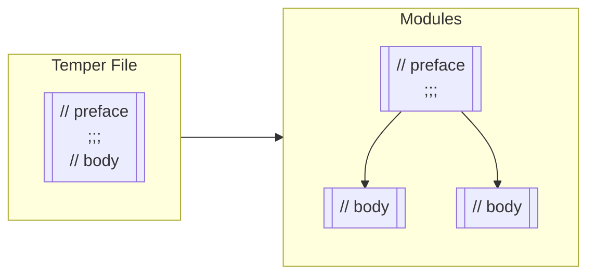

# Modules & Files

## File name extensions and Markdown embedding

Temper source files are identified by their file name extension. For
now, these are:

- `.temper`
- `.temper.md`

In the former case, that's a plain Temper source file. In the latter
case, it's Temper embedded in a Markdown document, enabling
(semi-)literate programming. We might add other official file name
extensions or document languages to embed Temper within in the future.

In Temper Markdown, the file starts out in comment mode. That is, the
text of the document is a comment to the Temper compiler. Temper code
goes inside code blocks:

````tempermd
# My Temper Markdown source file

This is text. You can treat it as a document.

```temper
// This is active Temper code.
let greet(name: String): Void {
  console.log("Hello, ${name}!");
}
```

Within `.temper.md` files, the default code block type is `temper`,
so you can leave off the label:

```
// Still Temper.
greet("world");
```

Or even use indented blocks:

    // And still Temper.
    greet("everyone");

If you want a block of Temper for documentation purposes but which you
don't want to be active, you can call it `inert`:

```temper inert
console.log("Inert code doesn't run.");
```
````

All Temper code blocks start and end on new lines. We might also
require blocks to begin and end at statement boundaries.

### Documenting declarations in prose

In a `.temper.md` file, prose can document the declaration that
follows it. The doc starts at the first top-level paragraph whose first
word is the declared name (case doesn't matter, and `` ` `` or `*`
around it is ignored, as in "`` `area` `` is …" or "**Square** holds …").
It runs to the declaration and includes the Markdown in between as
written: paragraphs, lists, block quotes, example code blocks (such as
```` ```temper inert ````), and link reference definitions. HTML blocks
are left out. A heading or thematic break ends the doc, so prose before
one documents nothing after it, and a declaration's doc must start after
the last one:

````tempermd
Some introduction, which documents nothing.

`area` is the area of a square.

It's side times side.

```temper
export let area(side: Int): Int { side * side }
```

**Square** holds a side.

```temper
export class Square(public side: Int) {}
```
````

A doc comment, `/** … */`, right before the declaration still wins
over prose. Editors show the documentation on hover, as does the REPL's
`help`. Its first paragraph is its summary; it stays Markdown. Define
links within the doc (or write them inline), since definitions elsewhere
in the file don't come along.

## Parts of a Temper source file

In Temper, [`import`](builtins.md#import), works on *module*s, not files or
directories. Normally, there is a 1:1 relationship. Each *directory* (or
folder) specifies one module, but that is not always the case. All
Temper source files in a module directory are merged into a single
module, irrespective of file names, except for library configuration
files named "config.temper.md". Each such config file specifies the root
of a library.

Further, a *module preface* allows you to specify definitions shared by
all instances of the module's body. All preface content from all Temper
source files in a module are merged together.

If a preface specifies no *module parameters* then there will be
exactly one module instance, corresponding to the empty parameter set.

If it specifies parameters, then there may be zero or more
instances.



The instances of a module are determined by the parameters
passed when `import`ing that module.
There will be one instance for each distinct parameterization
so if multiple modules import with the same parameters, they
will share an instance.

> **Note:** neither compiler implements module prefaces or module
> parameters today: both read one `;;;` as separating code from JSON
> metadata after it, as the third row of the table below would have it
> without a preface
> ([inconsistencies](../inconsistencies.md#i19-module-prefaces-and-)).

The parts of a Temper source file are separated by
triple-semicolon `;;;` tokens.  Since this is token-based,
`;;;` character sequences inside a comment or string literal
do not affect the structure of the file.

- If there are no `;;;` tokens, then the source file has an
  empty preface, and all tokens are in the body.
- If there is one `;;;` token, then it separates the
  preface before from the body after.
- If there are two `;;;` tokens, then the tokens after the
  second must be well-formed JSON, and may be used by tools
  to store metadata about the file.
- If there are three or more `;;;` tokens, the file is malformed.

|           |       |           |       |            |       |           |
| --------- | ----- | --------- | ----- | ---------- | ----- | --------- |
| *Body*    |       |           |       |            |       |           |
| *Preface* | `;;;` | *Body*    |       |            |       |           |
| *Preface* | `;;;` | *Body*    | `;;;` | *Metadata* |       |           |
| *Invalid* | `;;;` | *Invalid* | `;;;` | *Invalid*  | `;;;` | *Invalid* |
